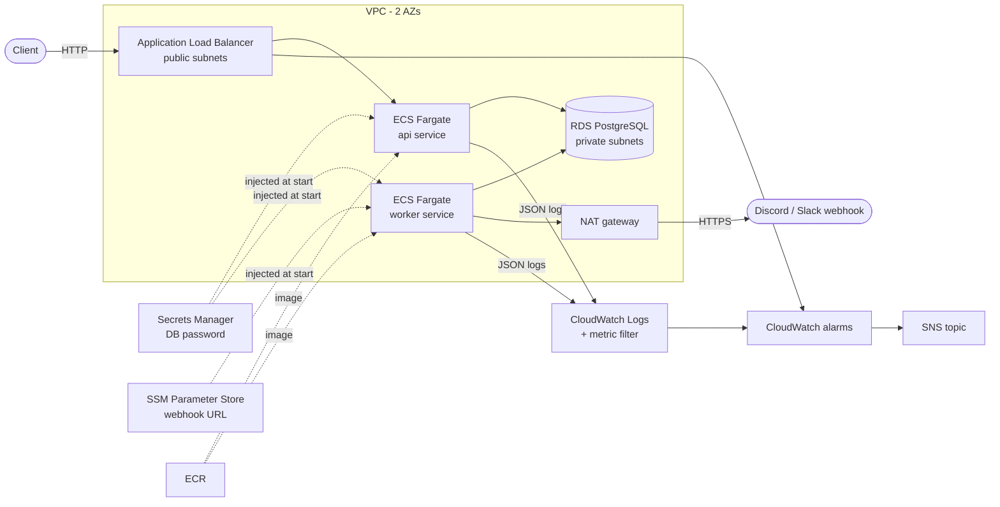
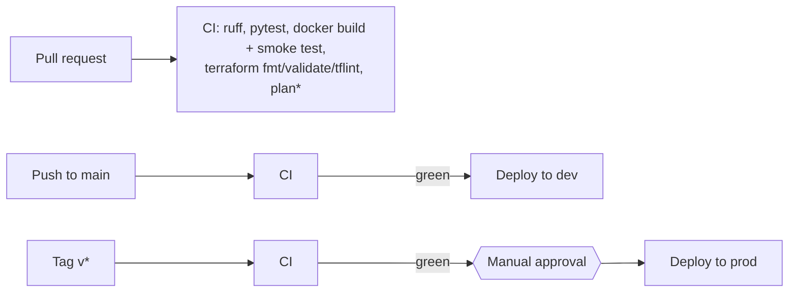

# PostPilot

PostPilot schedules social media posts and publishes them to a chat webhook
(Discord or Slack) when they are due. The app is deliberately small. The point
of the project is everything around it: containers, a local observability
stack, infrastructure as code for AWS, and a CI/CD pipeline with safe deploys.

- **API** (FastAPI): create, list and cancel scheduled posts.
- **Worker**: polls Postgres for due posts and sends them to the webhook, with retries.
- **Ops endpoints**: `/healthz` (liveness), `/readyz` (can reach the DB), `/metrics` (Prometheus).
- **Logs**: one JSON object per line, so CloudWatch can filter on fields.

## Architecture





\* `terraform plan` and the deploy jobs only run when AWS is configured (see below). Without
it they are skipped with a notice and the pipeline stays green.

## Repository layout

| Path | What it is |
| --- | --- |
| `postpilot/` | Application code (API, worker, publisher, metrics, logging) |
| `tests/` | pytest unit and API tests (SQLite, mocked webhook) |
| `Dockerfile` | Multi-stage build, runs as non-root user 10001 |
| `docker-compose.yml` | Local stack: api, worker, Postgres, Prometheus, Grafana, mock webhook |
| `observability/` | Prometheus scrape config and Grafana provisioning + dashboard |
| `scripts/smoke_test.sh` | End-to-end check used locally and in CI |
| `infra/modules/` | Terraform modules: network, ecr, ecs, rds, secrets, observability |
| `infra/envs/{dev,prod}` | One root module per environment |
| `infra/bootstrap/` | One-time setup: state bucket, lock table, GitHub OIDC roles |
| `.github/workflows/` | `ci.yml` and `deploy.yml` |
| `docs/` | [Runbook](docs/runbook.md) and [design decisions](docs/decisions.md) |

## Local quickstart

Requirements: Docker. Python 3.12 only if you want to run tests outside Docker.

```bash
docker compose up -d --build
./scripts/smoke_test.sh          # schedules a post and checks the mock webhook got it

# Try it by hand
curl -X POST localhost:8000/posts -H 'Content-Type: application/json' \
  -d '{"content": "Hello from PostPilot", "channel": "general", "publish_at": "2030-01-01T09:00:00Z"}'
curl localhost:8000/posts
curl -X POST localhost:8000/posts/1/cancel
curl localhost:8080/received     # what the mock webhook has received

docker compose down -v
```

| URL | |
| --- | --- |
| http://localhost:8000/docs | API (Swagger UI) |
| http://localhost:9090 | Prometheus |
| http://localhost:3000 | Grafana, dashboard "PostPilot overview" (anonymous view, admin/admin to edit) |
| http://localhost:9100/metrics | Worker metrics |

To see failures and retries on the dashboard, make the mock webhook fail some requests:

```bash
MOCK_WEBHOOK_FAIL_RATE=0.5 docker compose up -d mock-webhook
```

### Tests

```bash
python3.12 -m venv .venv && source .venv/bin/activate
pip install -r requirements-dev.txt
ruff check . && ruff format --check .
pytest --cov
```

Tests use a throwaway SQLite file per test and an `httpx.MockTransport` instead of a real webhook,
so they need no network or database.

### Configuration

All settings are environment variables.

| Variable | Default | Notes |
| --- | --- | --- |
| `DATABASE_URL` | SQLite file | Used locally. On ECS it is built from `DB_HOST`, `DB_USER`, `DB_PASSWORD`, `DB_NAME`, `DB_SSLMODE` |
| `WEBHOOK_URL` | none | Required by the worker |
| `POLL_INTERVAL_SECONDS` | 5 | Worker poll interval |
| `BATCH_SIZE` | 20 | Max posts per poll |
| `MAX_ATTEMPTS` | 3 | After this many failed deliveries a post is marked `failed` |
| `RETRY_BACKOFF_SECONDS` | 30 | Retry delay, doubled after each failure |
| `LOG_LEVEL` | INFO | |

## How the worker stays safe

- Due posts are claimed with `SELECT ... FOR UPDATE SKIP LOCKED`. Two workers (or an old
  and a new one during a rolling deploy) never publish the same post.
- Cancel takes a row lock too, so cancelling cannot race a publish.
- On `SIGTERM` (what ECS sends before stopping a task) the worker finishes its current
  batch and exits.
- A failed delivery is retried with exponential backoff, then marked `failed` with the last error.

## CI/CD

**`ci.yml`** runs on every pull request, on pushes to `main`, and on `v*` tags:

1. `ruff check`, `ruff format --check`, `pytest` with coverage (fails under 90%).
2. Builds the Docker image, checks it runs as a non-root user, starts the compose stack and
   runs `scripts/smoke_test.sh` against it.
3. For `infra/envs/dev`, `infra/envs/prod` and `infra/bootstrap`: `terraform fmt -check`,
   `terraform init -backend=false`, `terraform validate`, `tflint`.
4. `terraform plan` for dev and prod, only if `AWS_PLAN_ROLE_ARN` and `TF_STATE_BUCKET` are set.

**`deploy.yml`** starts when a CI run finishes. It only continues if CI passed on a push:

- push to `main` -> **dev**
- tag `v*` -> **prod**. The job uses the `prod` GitHub environment; add yourself as a
  required reviewer there and the deploy waits for your approval.

Deploy steps: build the image, push it to ECR tagged with the git SHA, register a new task
definition revision for `api` and `worker`, update each service, and wait until it is stable.
ECS does a rolling deploy (new tasks start before old ones stop). If the new tasks fail their
health checks, the **deployment circuit breaker** rolls the service back to the previous
revision and the workflow fails.

AWS access uses **GitHub OIDC**: the job asks GitHub for a short-lived token and exchanges it for
temporary credentials for an IAM role. No AWS keys are stored in GitHub.

## Environments

| | dev | prod |
| --- | --- | --- |
| VPC CIDR | 10.10.0.0/16 | 10.20.0.0/16 |
| NAT gateways | 1 (shared) | 2 (one per AZ) |
| API tasks | 1-2 x 0.25 vCPU / 512 MiB | 2-6 x 0.5 vCPU / 1 GiB |
| Worker tasks | 1 | 2 |
| RDS | db.t4g.micro, single-AZ, 1 day backups | db.t4g.small, Multi-AZ, 7 day backups, deletion protection |
| Log retention | 7 days | 30 days |
| Alarm thresholds | 5% 5xx, p95 1s, 5 publish failures | 2% 5xx, p95 0.5s, 3 publish failures |
| Deploys | every green push to `main` | `v*` tag + manual approval |

## Deploying to AWS

This repo has not been applied to a real AWS account; everything below is validated with
`terraform validate` and `tflint` in CI. To use it:

1. **Bootstrap** (once, with admin credentials):
   ```bash
   cd infra/bootstrap && terraform init && terraform apply
   ```
   This creates the state bucket, the DynamoDB lock table, the GitHub OIDC provider, and two
   roles: `postpilot-github-plan` (read-only, for PRs) and `postpilot-github-deploy`
   (ECR push + ECS update, only from the `dev`/`prod` GitHub environments).
2. **GitHub settings**: add repository variables `AWS_PLAN_ROLE_ARN`, `AWS_DEPLOY_ROLE_ARN`,
   `TF_STATE_BUCKET`, and optionally `AWS_REGION` (default `us-west-2`). Create environments
   `dev` and `prod`, and add a required reviewer to `prod`.
3. **First apply** of an environment. The ECS services need an image to exist, so create
   the repository first, push an image, then apply the rest:
   ```bash
   cd infra/envs/dev
   cp backend.hcl.example backend.hcl   # fill in the bucket name
   terraform init -backend-config=backend.hcl
   terraform apply -target=module.ecr
   # docker build/push the image to the repo as :bootstrap (see terraform output ecr_repository_url)
   terraform apply
   aws ssm put-parameter --name /postpilot-dev/webhook-url --type SecureString --overwrite --value 'https://discord.com/api/webhooks/...'
   ```
4. From then on, pushes to `main` deploy dev automatically.

### Cost

Rough on-demand estimate for us-west-2 if left running 24/7 (check the AWS pricing
calculator before applying):

- **dev: about $80/month.** NAT gateway ~$33, ALB ~$17, two small Fargate tasks ~$18,
  db.t4g.micro + 20 GB ~$15, CloudWatch a few dollars.
- **prod: about $200/month.** Two NAT gateways, Multi-AZ RDS and more tasks roughly double it.

The NAT gateway is the biggest fixed cost. For a demo, apply dev, try it, and destroy it the same day:

```bash
cd infra/envs/dev && terraform destroy
```

Prod has deletion protection on RDS and the ALB; turn those off in `main.tf` and apply before
destroying.

## Observability

- **Metrics** (Prometheus format):
  - worker: `posts_published_total`, `publish_failures_total`,
    `publish_latency_seconds` (histogram), `queue_backlog` (gauge: due posts not yet sent)
  - api: `http_requests_total{method,route,status}`, `http_request_duration_seconds`
- **Grafana** dashboard (`observability/grafana/dashboards/postpilot.json`): publish rate,
  failures, latency percentiles, backlog, API traffic by status, API p95 by route.
- **AWS**: CloudWatch alarms on ALB 5xx rate, ALB p95 latency, unhealthy targets, ECS CPU per
  service, and publish failures (a log metric filter on `{"message": "publish_failed"}` from the
  worker's JSON logs). All alarms notify one SNS topic. What to do for each alarm is in
  [docs/runbook.md](docs/runbook.md).

Locally Prometheus scrapes `/metrics`. On AWS the alarms use CloudWatch metrics instead, so
there is no Prometheus server to run; the next step would be Amazon Managed Prometheus or the
CloudWatch agent scraping `/metrics`.

## Known limitations

- Tables are created on startup (`create_all`). A real service would use Alembic migrations
  run as a one-off ECS task before the deploy.
- The ALB serves HTTP unless you pass an ACM `certificate_arn`.
- The prod deploy rebuilds the image from the tagged commit instead of promoting the exact
  image that ran in dev (see ADR-007 in [docs/decisions.md](docs/decisions.md)).
